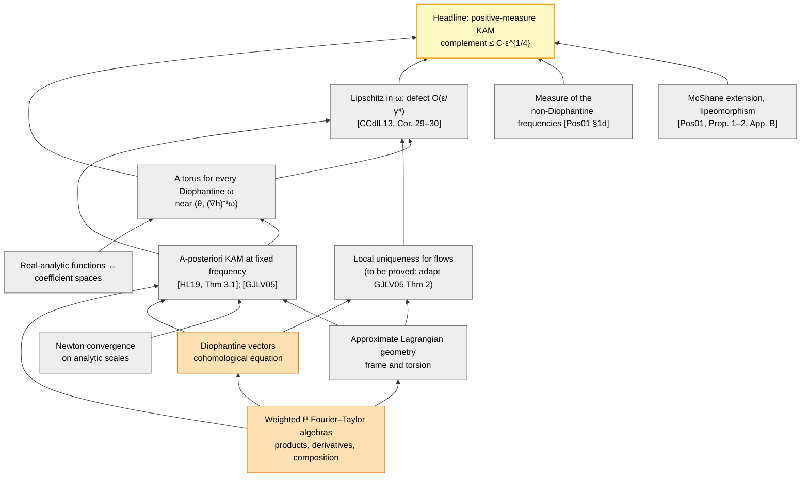

# KAM-dev — campaign HQ

Lean 4 + Mathlib formalization of the **Kolmogorov–Arnold–Moser theorem** in its positive-measure form:
for a nearly-integrable real-analytic Hamiltonian H(θ, I) = h(I) + f(θ, I) with a Kolmogorov-nondegenerate
h, most of phase space is filled by invariant Lagrangian tori that carry quasi-periodic motion with
Diophantine frequencies, as soon as f is small enough.

**Authors:** Scott Armstrong and Zohar Komargodski. Public development repository.

<!-- AUTO:updated -->
> **Last updated: 2026-10-27 16:51 UTC** (automatic: every 20 minutes and after every commit) · **estimated completion 24.5 %** · frozen statements proved: 0 / 5 · **2,758 lines of Lean** of an estimated ≈ 40,000
<!-- /AUTO:updated -->

## Overview

**The theorem (draft target; not yet frozen).** Let B ⊂ ℝⁿ be a bounded domain and h real-analytic on a complex
neighbourhood of B̄, with frequency map ∇h a diffeomorphism of B onto its image (det ∇²h ≠ 0). For every
κ > 0 there is ε₀ > 0 such that, for every f real-analytic on a fixed complex neighbourhood of Tⁿ × B̄ with
sup norm ≤ ε₀ there, the points of Tⁿ × B that lie on invariant tori of H = h + f have Lebesgue measure at
least (1 − κ)·|Tⁿ × B|. Each such torus is a real-analytic embedded Lagrangian torus close to {I = const}, and
the flow of H on it is conjugate to the linear flow θ ↦ θ + tω with a Diophantine frequency ω. Quantitative form
that the route delivers: the complement has measure ≤ C·ε^{1/4}, where ε = sup |f| (owner question Q1; the optimal
ε^{1/2} needs canonical-transformation methods). The exact statement will be transcribed from the pinned sources,
approved by the owner as Lean code, and frozen.

**Route** (decision D2). No canonical changes of variables and no action-angle normal forms:
1. **A-posteriori KAM at fixed frequency** ([HL19, Thm 3.1](https://arxiv.org/abs/1711.05515v1) with d = n;
   cross-checked against [GJLV05](https://doi.org/10.1088/0951-7715/18/2/020)). An approximately invariant
   torus with small error and a nondegenerate torsion lies near a true invariant torus. The proof is a Newton
   method on the torus embedding: matrix identities from the approximate Lagrangian property, constant-coefficient
   cohomological equations, Neumann-series inverses.
2. **One torus per Diophantine frequency.** Apply 1 to the unperturbed torus (θ, (∇h)⁻¹ω) of the nearly-integrable
   system; the invariance error is the size of the perturbation.
3. **Measure.** Local uniqueness for flows, which no source states (we prove it, adapting
   [GJLV05](https://doi.org/10.1088/0951-7715/18/2/020) Thm 2), and re-application of step 1 at nearby
   frequencies ([CCdlL13](https://doi.org/10.1016/j.jde.2013.05.001), Cor. 29–30) make the tori depend on the
   frequency with Lipschitz defect O(ε/γ⁴). A McShane extension ([Pos01](https://arxiv.org/abs/0908.2234v1),
   Prop. 1–2 and App. B) turns this into a lipeomorphism. The complement of the tori is then the image of the
   non-Diophantine set, of measure O(γ). Taking γ ~ ε^{1/4} gives the rate.
4. **Framework.** Internally everything is coefficient arithmetic in weighted ℓ¹ Fourier(–Taylor) norms
   ‖f‖ = Σ |f̂ₖₘ| e^{|k|s} r^{|m|} (a Banach algebra: derivative, composition and cohomological estimates are
   termwise). Hypotheses are stated for real-analytic functions and converted once at the interface.

**How the campaign works.** The statements we must prove are fixed first. The headline theorem, a few gate
theorems and the definitions they use are written in Lean, approved by the owner line by line, and frozen: one
declaration per file, hashed in [`manifest/frozen-anchors.json`](manifest/frozen-anchors.json), never edited.
Each frozen theorem starts with the proof `sorry`. Agents prove it in a separate provider module, and the
orchestrator *seals* it: the `sorry` becomes `by exact Provider.<name>`, and the checks (hashes, axioms, kernel
replay, build) run again. A result counts as formalized only when its frozen statement is sealed.

---

## At a glance

<!-- AUTO:progress -->
### Estimated completion: **24.5 %**

`██████░░░░░░░░░░░░░░░░░░░` 24.5 %

| Part of the project | Items | Weight | Done | Completion |
|---|---|---|---|---|
| Statement and planning | 8 | 26 | 18.3 | `███████░░░` 71 % |
| Campaign infrastructure | 4 | 5 | 3.0 | `██████░░░░` 60 % |
| Analytic infrastructure | 8 | 24 | 3.4 | `█░░░░░░░░░` 14 % |
| A-posteriori KAM at fixed frequency | 4 | 24 | 0.0 | `░░░░░░░░░░` 0 % |
| Measure of the invariant tori | 5 | 12 | 0.0 | `░░░░░░░░░░` 0 % |
| Track I (isoenergetic, confinement, R3BP) | 2 | 12 | 3.2 | `███░░░░░░░` 27 % |
| Track N (Nekhoroshev) | 2 | 12 | 3.2 | `███░░░░░░░` 27 % |
| Track P (planetary) | 3 | 20 | 3.2 | `██░░░░░░░░` 16 % |
| Sealing of the frozen statements | 5 | 5 | 0.0 | `░░░░░░░░░░` 0 % |
| **Total** | 41 | 140 | 34.4 | **24.5 %** |

**How this is estimated.** The project is divided into 36 work items: the planning deliverables, the campaign infrastructure, and every node of the proof map below. Each item is weighted by its difficulty (low 1, moderate 2, high 4, very high 8); each sealed frozen statement adds 1. An item counts with the fraction of it that is done: for a Lean item, the fraction proved on `main`; for a planning item, the lead's assessment. Item assessment last reviewed: **2026-10-27 16:05 UTC**. The percentage is recomputed automatically; it measures done work, so the high-weight proof items dominate what is left. File: [`docs/campaign/progress.json`](docs/campaign/progress.json).

<details><summary>All work items with their weight and status</summary>

| ID | Item | Difficulty | Done | Note |
|---|---|---|---|---|
| S.SURVEY | Literature survey: candidate sources, prior formal work, Mathlib inventory | M | ✅ 100 % | three research reports (2026-10-27): sources, warm-ups and norms, prior formalizations |
| S.SOURCES | Pinned source library: PDFs with SHA-256, bibliographic data checked against arXiv and Crossref | L | 🟨 85 % | 50 PDFs pinned in sources/SHA256SUMS; 20 in the registry; per-paper summaries still to write |
| S.ROUTE | Route verdict for the measure layer (a-posteriori KAM + Lipschitz dependence on the frequency) | H | 🟨 90 % | verdict: route works; rate ε^{1/4}; flow local uniqueness must be proved by us (no published version) |
| S.STMT | Mathematical statement of the headline theorem and the gate theorems, with owner rulings | M | ✅ 100 % | docs/statement.md draft 0.2, approved |
| S.LEAN | Exact Lean statements (headline + gates): independent audit, owner approval, freeze | H | ✅ 100 % | approved (D11) and frozen: 5 theorem anchors + 20 definitions, manifest with file/prefix/ABI hashes |
| S.BP | Blueprint: every proof step written out against the pinned sources | VH | 🟨 70 % | all parts drafted (p2, p3, p4 complete; p1 interface of 30 lemmas, proofs being written); p3 review passed with fixes; p2, p4 reviews running |
| S.GRAPH | Source-level dependency graph anchored to the frozen statements | H | ⬜ 0 % |  |
| S.ERRATA | Errata and deviations ledger for every formalized source (continuous) | L | 🟨 30 % | ledger: 8 candidate errata, 6 planned deviations |
| I.REPO | Repository: toolchain v4.35.0, Mathlib v4.35.0, module-system checks, source lint | L | ✅ 100 % |  |
| I.HQ | Campaign HQ: this README, generator, 20-minute cron and post-commit hook | L | 🟨 80 % |  |
| I.GUARDS | Freeze machinery: manifest, anchor guard, quarantine, kernel replay, mutation suite | M | 🟨 60 % | anchor guard (Unicode-aware), ABI hashes, lint; manual mutation tests pass (3/3); kernel replay and mutation suite to do |
| I.BUILD | Shared build snapshot for worktrees and machine-wide compile gate | L | ⬜ 0 % |  |
| F.ALG | Weighted ℓ¹ Fourier algebra on ℤⁿ: Banach algebra, exp, derivatives, averages | H | 🟨 30 % | Zohar: weighted norm, derivative bound (period one), convolution summability and submultiplicativity (KAM/Fourier) |
| F.FT | Fourier–Taylor algebra in (angles, actions); Cauchy estimates in the actions | H | ⬜ 0 % |  |
| F.COMP | Composition f∘(id+u) and Taylor remainders in the weighted norms | H | ⬜ 0 % |  |
| F.MAT | Matrix-valued functions: products, Neumann-series inverses, averages | M | 🟨 50 % | Zohar: quantitative matrix Neumann estimates (KAM/Matrix) |
| F.BRIDGE | Bridge between real-analytic functions on complex strips and coefficient spaces | H | ⬜ 0 % |  |
| F.DIOPH | Diophantine vectors; cohomological equation with Rüssmann's exponent | M | 🟨 60 % | Zohar: zero-average cohomological solver, uniqueness, small-divisor estimate, Lipschitz in ω (KAM/Diophantine); bridge to frozen KAM.IsDiophantine still to add |
| F.NEWTON | Abstract Newton/KAM convergence on a scale of analytic spaces | M | ⬜ 0 % |  |
| F.HAM | Hamiltonian vector fields in coordinates; invariant tori; quasi-periodic orbits as ODE solutions | M | ⬜ 0 % |  |
| K.GEOM | Approximate Lagrangian property, adapted symplectic frame, torsion matrix | H | ⬜ 0 % |  |
| K.STEP | Newton step: reduction of the linearized equation, cohomological equations, estimates | VH | ⬜ 0 % |  |
| K.ITER | Iteration and convergence: the a-posteriori existence theorem | H | ⬜ 0 % |  |
| K.UNIQ | Local uniqueness modulo phase for flows (no published version: adapt GJLV05 Thm 2, §6, §8) | VH | ⬜ 0 % |  |
| M.APPLY | Invariant torus for every Diophantine frequency of a nearly-integrable Hamiltonian | M | ⬜ 0 % |  |
| M.LIP | Lipschitz dependence of the tori on the frequency (re-application; defect O(ε/γ⁴)) | H | ⬜ 0 % |  |
| M.DMEAS | Measure of the non-Diophantine frequencies | M | ⬜ 0 % |  |
| M.IMAGE | McShane extension of F̂ − id and the lipeomorphism: the complement is the image of the complement | M | ⬜ 0 % |  |
| M.ASSEMBLY | Assembly of the headline theorem | M | ⬜ 0 % |  |
| I.PHASE0 | Sources, statements, owner approval, freeze | H | 🟨 80 % | statements audited approvable; review page published; awaiting owner approval and freeze |
| I.PROOF | Blueprint, graph and proofs (estimate, refined after Phase 0) | VH | ⬜ 0 % |  |
| N.PHASE0 | Sources, statements, owner approval, freeze | H | 🟨 80 % | statements audited approvable; review page published; awaiting owner approval and freeze |
| N.PROOF | Blueprint, graph and proofs (estimate, refined after Phase 0) | VH | ⬜ 0 % |  |
| P.PHASE0 | Sources, statements, owner approval, freeze | H | 🟨 80 % | statements audited approvable; review page published; awaiting owner approval and freeze |
| P.PROOF.PDKAM | Properly degenerate KAM: blueprint, graph, proofs | VH | ⬜ 0 % |  |
| P.PROOF.PLANAR | Planar two-planet and fixed-Sun applications: coordinates, secular normal form, nondegeneracy | VH | ⬜ 0 % |  |

</details>
<!-- /AUTO:progress -->

<!-- AUTO:size -->
### Size of the formalization

| | Lines of Lean |
|---|---|
| On `main` now | **2,758** (1,619 excluding blank lines and comments) · **+2,758** since 2026-10-27 13:33 UTC |
| Written on agent branches, not yet landed | 0 |
| **Estimated total at completion** | **≈ 40,000** |
| Estimated still to write | ≈ 37,000 |

**How the size is estimated.** The estimate is a planning figure (infrastructure ≈ 12k, a-posteriori theorem ≈ 15k, measure layer ≈ 8k, interfaces ≈ 5k lines); it switches to a rate-based estimate once 8 weight units of Lean work are done. History of all counts: [`docs/campaign/history.csv`](docs/campaign/history.csv).
<!-- /AUTO:size -->

<!-- AUTO:glance -->
*Generated 2026-10-27 16:51 UTC from `main` at `fa8f631` by `scripts/hq-status.py`.*

**Current phase:** Track K Phase 1: all blueprint parts drafted (p2 G1 1323 lines, p3 G2 830, p4 measure 1482); p3 review ACCEPT WITH FIXES; p2 and p4 reviews and the part-1 proofs running; then consolidation and graph extraction. Tracks I, N, P: statement audits and revisions.

**Frozen statements proved: 0 / 5** · frozen definitions: 20

**Lean on `main`:** 43 modules · 2,758 lines · 111 theorems · `sorry` outside frozen anchors: 0 files · `axiom` declarations: 0

```text
DRAFT_ANCHORS: 5 (KAM/Frozen/Theorems/AposterioriKam.lean, KAM/Frozen/Theorems/KamPositiveMeasure.lean, KAM/Frozen/Theorems/KamPositiveMeasureQualitative.lean, KAM/Frozen/Theorems/LocalUniquenessFlow.lean, KAM/Frozen/Theorems/VolumeNotDiophantineLe.lean)
UNREGISTERED_SORRIES: 0
DRAFT_IMPORT_VIOLATIONS: 0 (frozen-anchor guard, run at every landing)
SEALED: 0 / 5
```
<!-- /AUTO:glance -->

## Tracks

Four parallel tracks (decision D14; details in [`docs/TRACKS.md`](docs/TRACKS.md)):

| Track | Headline | Stage |
|---|---|---|
| **K** | Positive-measure KAM for nearly-integrable analytic Hamiltonians, complement ≤ C·ε^{1/4} | statements frozen; blueprint being written |
| **I** | All-time confinement in two degrees of freedom (isoenergetic KAM); restricted circular planar three-body problem | Phase 0: statements audited ([docs/tracks/I](docs/tracks/I)); awaiting owner approval |
| **N** | Nekhoroshev stability for quasi-convex Hamiltonians, exponents 1/(2n) | Phase 0: statement draft 0.1 ([docs/tracks/N](docs/tracks/N)); audit running |
| **P** | Properly degenerate KAM; planar two-planet problem; n planets around a fixed Sun; spatial n-body later | Phase 0: statements audited ([docs/tracks/P](docs/tracks/P)); awaiting owner approval |

The phase table below is track K's.

## Phases

| Phase | Content | Status |
|---|---|---|
| 0 | Survey, pinned sources, route verdict, mathematical statement, exact Lean statements approved and frozen | **done 2026-10-27** (D11) |
| 1 | Blueprint (every step written out against the pinned sources), source-level dependency graph | **next** |
| 2 | Proof campaign: infrastructure, a-posteriori KAM, measure layer, assembly | not started |
| 3 | Clean-up, elaboration test, errata and deviations record, public release | not started |

## What we are formalizing: the frozen statements

<!-- AUTO:statements -->
| ID | Source | Lean name | Status | Notes |
|---|---|---|---|---|
| **kam.aposteriori_kam.v1** | Theorem 3.1, pp. 16–18; Rem. 2.3, 3.2, 3.3; App. B (5.74)–(5.77) (ledger D-G1-1) | [`aposteriori_kam`](KAM/Frozen/Theorems/AposterioriKam.lean) | ⬜ not yet | G1 |
| **kam.kam_positive_measure.v1** | Classical KAM Theorem, p. 6, at rate ε^{1/4} (D8, D9; ledger D-MEAS-1) | [`kam_positive_measure`](KAM/Frozen/Theorems/KamPositiveMeasure.lean) | ⬜ not yet | HEAD |
| **kam.kam_positive_measure_qualitative.v1** | Classical KAM Theorem, p. 6 (D9 Q1: qualitative corollary) | [`kam_positive_measure_qualitative`](KAM/Frozen/Theorems/KamPositiveMeasureQualitative.lean) | ⬜ not yet | HEAD-Q |
| **kam.local_uniqueness_flow.v1** | Theorem 2, p. 862 (template for flows; ledger D-UNIQ-1) | [`local_uniqueness_flow`](KAM/Frozen/Theorems/LocalUniquenessFlow.lean) | ⬜ not yet | G2 |
| **kam.volume_not_diophantine_le.v1** | §1d, p. 5 | [`volume_not_diophantine_le`](KAM/Frozen/Theorems/VolumeNotDiophantineLe.lean) | ⬜ not yet | G3 |
<!-- /AUTO:statements -->

## The proof map

The planned dependency chain; arrows point from a result to what uses it. **Green**: proved. **Blue**: proved
conditionally on the nodes pointing into it. **Amber**: in progress. **Grey**: not started. **Yellow**: the
headline theorem. Node states are maintained in [`docs/campaign/campaign.json`](docs/campaign/campaign.json); the
plan behind them is [`docs/PLAN.md`](docs/PLAN.md).

<!-- AUTO:graph -->

<!-- /AUTO:graph -->

## What is formalized so far

<!-- AUTO:areas -->
| Area | Content | Modules | Lines | Theorems |
|---|---|---|---|---|
| [`KAM/Frozen/`](KAM/Frozen) | Owner-approved frozen statements and definitions (one per file, manifest-bound) | 25 | 974 | 5 |
| [`KAM/Fourier/`](KAM/Fourier) | Weighted ℓ¹ Fourier and Fourier–Taylor algebras, composition, Cauchy estimates | 3 | 359 | 24 |
| [`KAM/Diophantine/`](KAM/Diophantine) | Diophantine vectors, cohomological equation, measure of the Diophantine set | 5 | 543 | 35 |
| [`KAM/Strip/`](KAM/Strip) | Holomorphic functions on strips: Cauchy estimates, Fourier coefficients, cohomological equation | 4 | 665 | 38 |
| [`KAM/Matrix/`](KAM/Matrix) | Matrix-valued functions: Neumann series and inverse bounds | 1 | 145 | 9 |
| `KAM/Newton/` *(not created yet)* | Abstract Newton/KAM convergence on analytic scales | 0 | 0 | 0 |
| `KAM/Hamiltonian/` *(not created yet)* | Hamiltonian vector fields in coordinates, invariant tori, quasi-periodic orbits | 0 | 0 | 0 |
| `KAM/APosteriori/` *(not created yet)* | A-posteriori KAM theorem at fixed frequency and local uniqueness | 0 | 0 | 0 |
| `KAM/Measure/` *(not created yet)* | Lipschitz dependence on the frequency and the measure of the union of tori | 0 | 0 | 0 |
| [`KAM/Provider/`](KAM/Provider) | One provider module per frozen theorem, where its proof is assembled | 5 | 72 | 0 |
<!-- /AUTO:areas -->

## What the agents are doing now

Live state from [`docs/campaign/campaign.json`](docs/campaign/campaign.json), the agents' tmux sessions and their
branches. Rules for agents: [`AGENTS.md`](AGENTS.md). Builds:
- **Cap:** one targeted `nice -n 5 lake build <Module>` per agent at a time; never the whole library on a branch.
- **Reuse:** worktrees get a copy-on-write overlay on a snapshot of `main`'s build; nothing is rebuilt from scratch.

<!-- AUTO:workers -->
| Agent | Kind | Model | Account | State | Assignment | Branch | Unlanded commits |
|---|---|---|---|---|---|---|---|
| **orchestrator** | lead | Claude Opus 5.5 | claude-1 | 🔄 active | Campaign lead: sources, statements, assignments, landings, owner questions, this README | — | — |
| **zohar** | collaborator | — | GitHub zkomargo | 🔄 active | Co-author. Fourier and Diophantine infrastructure (KAM/Fourier, KAM/Diophantine); packages on docs/campaign/PACKAGES.md | — | — |
| **bp-meas** | blueprint writer | Claude Opus 5.5 | claude-1 | ✅ done | Blueprint part 4 (G3, HEAD, HEAD-Q) written: 1482 lines; in review | — | — |
| **track-I** `kam-track-i` | Phase 0 (Codex) | GPT-6-Astra high | codex-1 | ✅ handed off | Track I Phase 0 done: isoenergetic KAM gate, 2-DOF all-time confinement, restricted three-body near-circular theorem, Kepler determinant gate; audit running | — | — |
| **track-N** `kam-track-n` | Phase 0 (Codex) | GPT-6-Astra high | codex-3 | ✅ handed off | Track N v0.2: N-HEAD kept (F-N1 open) plus N-HEAD-C with complex Hessian bound and frequency lower bound (Poschel 1993 Thm 1) | — | — |
| **track-P** `kam-track-p` | Phase 0 (Codex) | GPT-6-Astra high | codex-4 | ✅ handed off | Track P v0.2: all nine audit findings adopted (disc cylinder, diffeomorphism on W ⊇ closure V, boundary-layer guard) | — | — |
| **zohar-shorter-times** `kam-zohar2` | exploration (Codex) | GPT-6-Astra xhigh | codex-1 | ✅ handed off | Collaborator's research question: rounds 1–2 done (docs/explorations/almost-every-*.md); round 3 refutation running | — | — |
| **audit-N** `kam-audit-n` | statement audit (Codex) | GPT-6-Astra xhigh | codex-3 | ✅ handed off | Track N delta audit v0.2: N-HEAD-C approvable; N-HEAD faithful with source gap F-N1 open | — | — |
| **audit-P** `kam-audit-p` | statement audit (Codex) | GPT-6-Astra xhigh | codex-4 | ✅ handed off | Track P delta audit v0.2: all statements APPROVABLE; P-G true as corrected | — | — |
| **audit-I** `kam-audit-i` | statement audit (Codex) | GPT-6-Astra xhigh | codex-1 | ✅ handed off | Track I audit v0.1: all 4 theorems and 15 definitions APPROVABLE; minor fixes applied (author header, three source locators) | — | — |
| **bp-p1** | blueprint writer | Claude Opus 5.5 | claude-1 | 🔄 running | Proofs of the 30 part-1 interface lemmas | — | — |
| **round3-refute** | research referee | Claude Opus 5.5 | claude-1 | 🔄 running | Round 3: refute-first check of the round-2 planetary claims (P-EXP-SAFE, secular box, averaging corrections) | — | — |

**Queued:** Owner approval: track I (claude.ai/artifact/5B9odMattAPViUVYUgNPDK), track P (claude.ai/artifact/QWmEaWZobMJmfs4fKz63D1), track N (claude.ai/artifact/YRbRbLgwvj9QZ6gKFFaM5H) · Blueprint consolidation (p2/p3 shared geometry, p3 copies, stale request sections; reviews p2 and p3) · Dependency graph extraction for track K
<!-- /AUTO:workers -->

### Recent changes on `main`

<!-- AUTO:landed -->
| When (UTC) | Commit | Change |
|---|---|---|
| 2026-10-27 16:51 | `fa8f631` | Track N delta audit v0.2: N-HEAD-C approvable; review pages for tracks I, N, P await owner approval |
| 2026-10-27 16:41 | `34dbf4d` | Packages: I-STRIP-5 (several-variable holomorphic implies analytic) opened; Zohar's I-STRIP-4 credited |
| 2026-10-27 16:41 | `da61a77` | Blueprint Part 4 review: ACCEPT WITH FIXES; major F1 (several-variable holomorphic implies analytic) becomes a Part 1 lemma and package I-STRIP-5 |
| 2026-10-27 16:40 | `32e70fa` | Track P delta audit v0.2: approvable; review page published for owner approval |
| 2026-10-27 16:33 | `2b84d71` | Exploration round 2: exponential-time safety for all low-AMD planetary data, secular Jupiter-Saturn box, ranked milestones; round 3 refutation running |
| 2026-10-27 16:29 | `cac339c` | Merge remote-tracking branch 'origin/main' |
| 2026-10-27 16:29 | `a034fc9` | Track N v0.2: complex-bound headline variant N-HEAD-C; delta audit running |
| 2026-10-27 16:25 | `f08858a` | Track P v0.2: all audit findings adopted; delta audit running |
| 2026-10-27 16:24 | `42c831a` | Blueprint Part 2 review: ACCEPT WITH FIXES (minor only); E-HL19-7 reclassified; track I review page published |
| 2026-10-27 16:23 | `6d0dfa8` | Track I statement audit v0.1: all statements approvable; minor locator corrections applied |
| 2026-10-27 16:23 | `073dee6` | Blueprint Part 4: G3, HEAD and HEAD-Q from G1 and G2, complete proof |
| 2026-10-27 16:15 | `ddec667` | Track N statement audit v0.1: approvable with changes; source gap F-N1 (uniformity in h needs a complex Hessian bound); revision v0.2 under way |
<!-- /AUTO:landed -->

## Decisions

Full text: [`docs/DECISIONS.md`](docs/DECISIONS.md).

- **D1** Headline: the positive-measure KAM theorem for nearly-integrable real-analytic Hamiltonians on
  Tⁿ × B, general h (Kolmogorov nondegenerate). *(Scott, 2026-10-27)*
- **D2** Route: a-posteriori KAM at fixed frequency (parameterization method, no action-angle changes of
  variables), one torus per Diophantine frequency, measure via Lipschitz dependence on the frequency.
  Weighted ℓ¹ Fourier(–Taylor) norms internally; flows, not maps; coordinates on ℝⁿ with ℤⁿ-periodicity, not
  manifolds. *(Scott accepted the orchestrator's recommendation, 2026-10-27)*
- **D3** Independent development; the existing Lean formalization of Arnold's 1963 theorem (below) is a
  reference, not a dependency. *(Scott, 2026-10-27)*
- **D4** Toolchain `leanprover/lean4:v4.35.0`, Mathlib `v4.35.0` (Palomar's minimum is `v4.35.0-rc2`).
- **D5** Frozen-anchor workflow: statements frozen before proofs; one declaration per frozen file; sealing by
  `by exact Provider.<name>`; Lean module system everywhere.
- **D6** This README is regenerated at least every 20 minutes and after every commit; an errata and deviations
  ledger is kept for every formalized source. *(Scott, 2026-10-27)*
- **D7** Hosting: public GitHub repository `scottnarmstrong/KAM-dev` (source PDFs stay out of git). *(Scott)*
- **D11** Statements approved and frozen: 5 theorem anchors and 20 definitions. *(Scott, 2026-10-27)*
- **D14** Parallel tracks K, I, N, P: formalize the planetary programme too. *(Scott, 2026-10-27)*
- **D15** Authors: Scott Armstrong and Zohar Komargodski. *(Scott)*
- **D8** Route verdict: rate ε^{1/4}; local uniqueness for flows is proved by us; Lipschitz dependence by
  re-application (CCdlL13); measure step by McShane extension (Pos01). *(orchestrator, 2026-10-27; revisable)*

## Owner questions

All answered: Scott accepted the recommendations on Q1–Q5 (2026-10-27), recorded as D9 in
[`docs/DECISIONS.md`](docs/DECISIONS.md).

| | Question | Ruling |
|---|---|---|
| Q1 | Rate in the frozen headline? | Yes: meas(complement) ≤ C·ε^{1/4}; the qualitative (1 − κ) form, with no boundary condition, is a corollary. |
| Q2 | Angle period? | 1: Tⁿ = ℝⁿ/ℤⁿ. |
| Q3 | Content of "invariant torus"? | Invariant, carrying the linear flow with a Diophantine frequency; Lagrangian; real-analytic embedding; close to the unperturbed torus. |
| Q4 | Gates besides the headline? | The fixed-frequency a-posteriori theorem, local uniqueness for flows, and the measure of the Diophantine set. |
| Q5 | Standing assumptions? | n ≥ 2; B bounded with regular boundary (rate form only); ∇h bi-Lipschitz on B̄; h + f real-analytic on a uniform complex neighbourhood. |

## Errata and deviations

Ledger: [`docs/errata/ledger.json`](docs/errata/ledger.json); reader-facing record (written from the ledger,
verified independently before release): [`docs/ERRATA-AND-DEVIATIONS.md`](docs/ERRATA-AND-DEVIATIONS.md). Every
source we formalize gets entries for its errata (defects in the pinned text) and for our deviations from it
(conventions, reformulations, proof routes). Candidates imported from the literature stay `CANDIDATE` until checked
against the pinned PDF.

<!-- AUTO:errata -->
| Source | Errata (by status) | Deviations (by status) |
|---|---|---|
| CCdlL13 | 1 candidate | 1 planned |
| FdlLS09 | 2 candidate | 0 |
| GJLV05 | 5 candidate | 1 planned |
| HL19 | 7 candidate | 4 planned |
| Pos01 | 5 candidate | 2 planned |

<details><summary>All ledger entries</summary>

| ID | Type | Source | Location | Claim | Status |
|---|---|---|---|---|---|
| E-Pos01-1 | erratum | Pos01 | p. 29 (arXiv v1.3), footnote to Lemma A.2 | missing hypothesis: the condition Kσ ≥ 1 is missing in the printed version; the author's own footnote in arXiv v1.3 says so and the pinned arXiv version contains it | CANDIDATE |
| E-Pos01-2 | erratum | Pos01 | p. 23 (arXiv v1.3), choice of h₀ and K₀ in the proof of Theorem A | the choices of h₀ and K₀ violate h₀ ≤ α(2K₀^ν)⁻¹ (Bou20, footnote 1); Kou19 Rem. 2.1.5(4), p. 28: 'Theorem A and B are not valid for ν = τ+1' with that proof; Bou20 restores Theorem A as stated by Rüssmann approximation and a linear scheme | CANDIDATE |
| E-Pos01-3 | erratum | Pos01 | p. 13 (arXiv v1.3), measure statement after Theorem A | should be the measure of (Ω ∖ Ωα) × Tⁿ | CANDIDATE |
| E-GJLV05-1 | erratum | GJLV05 | p. 862, Theorem 3 (closeness bound) | presumably cγ^{−2}δ^{−2σ}, as in Theorems 1 and 5 | CANDIDATE |
| E-GJLV05-2 | erratum | GJLV05 | p. 865, Theorem 5 | ρ₀ is not defined in the statement (presumably ρ) | CANDIDATE |
| E-FdlLS09-1 | erratum | FdlLS09 | p. 13, Theorem 3.14 | δ is introduced but unused; the bound presumably involves δ | CANDIDATE |
| E-FdlLS09-2 | erratum | FdlLS09 | §7.1, pp. 42–43 | a bi-Lipschitz map ω ↦ K_ω into a function space does not by itself give a Lipschitz inverse of (θ, ω) ↦ K_ω(θ); the measure conclusion needs the argument we supply (D-LIP-1, D-MEAS-1) | CANDIDATE |
| E-CCdlL13-1 | erratum | CCdlL13 | pp. 31–32 (preprint mp_arc 11-188) | the two pages describe ℓ = 2 inconsistently | CANDIDATE |
| D-ROUTE-1 | deviation | Pos01 | whole proof | Proof route: the tori are obtained from an a-posteriori fixed-frequency KAM theorem (parameterization method, no canonical changes of variables) applied at each Diophantine frequency, not by Pöschel's iteration of symplectic transformations | PLANNED |
| D-MEAS-1 | deviation | Pos01 | Theorem (p. 6), Prop. 1–2 (p. 11) | Rate: our route proves meas(complement) ≤ C·ε^{1/4} (γ ~ ε^{1/4}), not Pöschel's O(√ε); the measure step applies the McShane extension of App. B to F̂ − id in frequency coordinates; in the proof the tori are parameterized by actions (not frequencies), so ∇h(B) needs no regular boundary (blueprint Part 4, V1–V2) | PLANNED |
| D-NORM-1 | deviation | HL19 | §3.1 (analytic functions and norms) | Estimates are carried out in weighted ℓ¹ Fourier(–Taylor) coefficient norms instead of sup norms on complex strips; hypotheses are stated for real-analytic functions and converted once at the interface | PLANNED |
| D-COORD-1 | deviation | HL19 | §2 (Hamiltonian systems and invariant tori) | Phase space Tⁿ × B is represented in coordinates: angles in ℝⁿ with ℤⁿ-periodicity, actions in an open set of ℝⁿ (no manifold structure, no general symplectic form) | PLANNED |
| D-UNIQ-1 | deviation | GJLV05 | Theorem 2 (maps), §6, §8 | Proof supplement: local uniqueness modulo phase for flows. No published statement exists in this framework (GJLV05 Rem. 7: 'We do not formulate such a theorem'; HL19 Rem. 3.5 asserts it without proof). We prove it by adapting the map proof of GJLV05 §6 with the flow reducibility of §8 and Prop. 18, directly for flows (not through the time-one map, which needs map-Diophantine frequencies).. Proof written in blueprint Part 3: linearization at K₁ (not K₂), the phase fixed once by ⟨BLᵀ(K₂(·+ψ) − K₁)⟩ = 0, a uniqueness constant independent of γ (∣ω∣ ≤ Γ from invariance, so γ ≤ Γ), the small-divisor exponent τ + n, and the conclusion on T_{ρ/2} | PLANNED |
| D-LIP-1 | deviation | CCdlL13 | Cor. 29–30 | Lipschitz dependence on the frequency by re-applying the a-posteriori theorem at a nearby frequency (CCdlL13 template), with the error estimate ‖E′‖ ≲ (ε + ‖K_ω − K⁰_ω‖_{C¹})·∣ω − ω′∣ and Lipschitz defect O(ε/γ⁴); refinements: stability always relative to the unperturbed torus, phase controlled by the average normalization, far pairs above λ_*γ² (blueprint Part 4, V3) | PLANNED |
| E-HL19-1 | erratum | HL19 | p. 18, (3.11) | the strict inequality is false when E = 0, where it would require ‖K∞ − K‖ < 0; it should read ≤ | CANDIDATE |
| E-HL19-2 | erratum | HL19 | p. 42, (5.66) | in the estimate for the twist term the denominator should be σ_T − ∣⟨T⟩⁻¹∣ | CANDIDATE |
| D-G1-1 | deviation | HL19 | Theorem 3.1, pp. 16–18; App. B (5.74)–(5.77) | Uniform constants: C₁, C₂ depend only on n, τ, ρ, ρ∞, a bound M for the Hamiltonian's derivatives, σK, σB, σT, a margin μ (gaps σ − ‖·‖ and distance to the boundary) and an upper bound γbar ≥ γ (App. B's constants increase with γ; without γbar the statement is false: machine-checked counterexample). Dropped hypotheses implied up to 2n factors: σ_{Kᵀ}, c_{X_hᵀ,1}; first integrals and the estimate on ⟨c∘K∞⟩ not transcribed. Pointwise operator norms on the open strip instead of sums of sups on the closed strip. Conclusion strengthened to explicit margins (μ/2) and ≤ in the closeness bound (cf. E-HL19-1). Same uniformization in our G2, where no γbar is needed: invariance with H2–H3 bounds ∣ω∣, hence γ; note: the hypotheses bound the frequency, γ ≤ ∣ω∣ ≤ 2nσ_Kσ_B(M + e), so γ̄ is needed only because the smallness condition alone does not bound e (Part 2 uses γ̄ once, to force e ≤ 1) | PLANNED |
| E-GJLV05-3 | erratum | GJLV05 | pp. 884–885, Lemma 14 (choice of the phase) | the proof never shows that Ψ maps Θ into itself, and Θ is open; Ψ(0) can be as large as ‖T‖_ρ‖K₁ − K₂‖_ρ. Correction: use the closed ball of radius 2‖T‖_ρ‖K₁ − K₂‖_ρ | CANDIDATE |
| E-GJLV05-4 | erratum | GJLV05 | p. 885, proof of Theorem 2 | should read 0 < δ < ρ/2 | CANDIDATE |
| E-GJLV05-5 | erratum | GJLV05 | p. 889, Prop. 18 | the derivative index should be θ_j, and the right-hand side norm should be ‖h‖_ρ | CANDIDATE |
| E-HL19-3 | erratum | HL19 | p. 55, Lemma A.1 | false for M̄ = M (it would give 0 < 0); should be ≤. Also (A.3)'s '< ½' only follows with ≤ | CANDIDATE |
| E-HL19-4 | erratum | HL19 | p. 33, (5.15)–(5.18); p. 43, (5.68) | false when E = 0; should be ≤ (the origin of E-HL19-1) | CANDIDATE |
| E-HL19-5 | erratum | HL19 | p. 42, after (5.67) | should refer to (5.13) and (5.17) | CANDIDATE |
| E-HL19-6 | erratum | HL19 | p. 44 | should read s → ∞ | CANDIDATE |
| E-HL19-7 | erratum | HL19 | p. 44 vs Theorem 3.1 (p. 17) | the proof's concluding sentence states the margin on the real torus only, but (5.73) does control dist(K_s(T_{ρ_s}), ∂B) on the complex strips, so the theorem's strip margin is proved; the sentence on p. 44 misstates what (5.73) gives | CANDIDATE |
| E-Pos01-4 | erratum | Pos01 | p. 6, after the definition of Ω_α | Hausdorff dimension n − 1 of the boundary does not give O(α) boundary layers. Counterexample: n = 1, Ω = (0,1) ∖ {1/k : k ≥ 1}: the boundary has dimension 0 but the inner α-layer has measure ≳ √α. The right condition is finite upper Minkowski content, or a layer bound as in our HEAD | CANDIDATE |
| E-Pos01-5 | erratum | Pos01 | p. 11, proof of Prop. 2 | the Lipschitz constant must be raised to the power n (Lipschitz maps scale n-dimensional measure by L^n; compare BC17 footnote 32) | CANDIDATE |
| D-LAG-1 | deviation | HL19 | §2.2, p. 7, eq. (2.3) | Proof supplement: the isotropy (Lagrangian property) of invariant tori with nonresonant frequency, asserted as well known, is proved in blueprint Part 4 (lemma lagrangian), citing GJLV05 Lemma 19 | PLANNED |

</details>
<!-- /AUTO:errata -->

## Papers

Pinned PDFs live in `sources/pdf/` (kept out of git); their SHA-256 hashes are in
[`sources/SHA256SUMS`](sources/SHA256SUMS). arXiv versions were read from the pinned PDFs; DOIs come from the arXiv
API or exact Crossref title matches. Registry: [`docs/sources.json`](docs/sources.json).

<!-- AUTO:papers -->
| Key | Reference | arXiv | DOI | Role |
|---|---|---|---|---|
| HL19 | A. Haro, A. Luque, *A-posteriori KAM theory with optimal estimates for partially integrable systems*, J. Differential Equations (2019) | [1711.05515v1](https://arxiv.org/abs/1711.05515v1) | [10.1016/j.jde.2018.08.003](https://doi.org/10.1016/j.jde.2018.08.003) | Primary for the fixed-frequency a-posteriori theorem: Thm 3.1 (§3.2) with d = n, explicit constants in App. B |
| GJLV05 | R. de la Llave, A. González, À. Jorba, J. Villanueva, *KAM theory without action-angle variables*, Nonlinearity 18 (2005) 855–895 | — | [10.1088/0951-7715/18/2/020](https://doi.org/10.1088/0951-7715/18/2/020) | A-posteriori theorem for flows (Thm 5, p. 865) and maps (Thm 1); local uniqueness for maps (Thm 2, p. 862; proof §6, pp. 883–885), the template for our flow version; automatic Lagrangian property (Lemma 19 / Prop. 18) |
| CCdlL13 | R. Calleja, A. Celletti, R. de la Llave, *A KAM theory for conformally symplectic systems: efficient algorithms and their validation*, J. Differential Equations 255 (2013) 978–1049 | — | [10.1016/j.jde.2013.05.001](https://doi.org/10.1016/j.jde.2013.05.001) | Lipschitz dependence on the frequency by re-applying the a-posteriori theorem (Cor. 29–30, normalization (5.3)); pinned preprint mp_arc 11-188 |
| Pos01 | J. Pöschel, *A lecture on the classical KAM theorem*, Proc. Symp. Pure Math. 69 (2001) 707–732 | [0908.2234v1](https://arxiv.org/abs/0908.2234v1) | — | Measure assembly: Prop. 1–2 (p. 11) with the Lipschitz (McShane) extension of App. B (p. 31); measure of Diophantine vectors (§1d, p. 5); pinned arXiv text is Version 1.3 (2009) |
| BC17 | L. Biasco, L. Chierchia, *Explicit estimates on the measure of primary KAM tori*, Ann. Mat. Pura Appl. (2018) | [1612.01903v1](https://arxiv.org/abs/1612.01903v1) | [10.1007/s10231-017-0678-8](https://doi.org/10.1007/s10231-017-0678-8) | Measure assembly in phase space: §6.5–6.6, Lemmas 5–6 (arXiv pp. 15–18) |
| FHL17 | J.-Ll. Figueras, A. Haro, A. Luque, *Rigorous computer assisted application of KAM theory: a modern approach*, Found. Comput. Math. 17 (2017) | [1601.00084v1](https://arxiv.org/abs/1601.00084v1) | [10.1007/s10208-016-9339-3](https://doi.org/10.1007/s10208-016-9339-3) | Explicit a-posteriori constants (Thm 2.5, maps); measure of Diophantine vectors (§4.1); Rüssmann estimates (§4.2) |
| FdlLS09 | E. Fontich, R. de la Llave, Y. Sire, *Construction of invariant whiskered tori by a parameterization method. Part I: Maps and flows in finite dimensions*, J. Differential Equations 246 (2009) 3136–3213 | [0903.0311v1](https://arxiv.org/abs/0903.0311v1) | [10.1016/j.jde.2009.01.037](https://doi.org/10.1016/j.jde.2009.01.037) | Local uniqueness (Thm 3.14) and dependence on the frequency (§7.1) |
| Vil17 | J. Villanueva, *A new approach to the parameterization method for Lagrangian tori of Hamiltonian systems*, J. Nonlinear Sci. 27 (2017) 495–530 | — | [10.1007/s00332-016-9342-5](https://doi.org/10.1007/s00332-016-9342-5) | Sharper a-posteriori theorem (Thm 2.6) with split error terms; pinned author copy |
| CK21 | L. Chierchia, C. E. Koudjinan, *V. I. Arnold's "global" KAM theorem and geometric measure estimates*, Regul. Chaotic Dyn. 26 (2021) | [2010.13243v1](https://arxiv.org/abs/2010.13243v1) | [10.1134/S1560354721010044](https://doi.org/10.1134/S1560354721010044) | Explicit measure estimates (cross-check of exponents and constants) |
| Sal04 | D. A. Salamon, *The Kolmogorov–Arnold–Moser theorem*, Math. Phys. Electron. J. 10 (2004), Paper 3 | — | — | Single-torus theorem with explicit constants (Thm 1); cross-check |
| Chi03 | L. Chierchia, *KAM lectures*, in: Dynamical Systems Part I, Pubbl. Cent. Ric. Mat. Ennio De Giorgi, SNS Pisa (2003) 1–56 | — | — | Configuration-space a-posteriori theorem (Thm 6) and weighted Fourier norms (App. B); scanned two-up PDF |
| CF24 | L. Chierchia, I. Fascitiello, *Nineteen fifty-four: Kolmogorov's new "metrical approach" to Hamiltonian dynamics*, Regul. Chaotic Dyn. (2024) | [2402.00178v1](https://arxiv.org/abs/2402.00178v1) | [10.1134/S1560354724550021](https://doi.org/10.1134/S1560354724550021) | Faithful restatement of Kolmogorov's 1954 theorems (statement fidelity) |
| Vil08 | J. Villanueva, *Kolmogorov theorem revisited*, J. Differential Equations 244 (2008) 2251–2276 | — | [10.1016/j.jde.2008.02.010](https://doi.org/10.1016/j.jde.2008.02.010) | Benchmarks γ ~ ε^{1/2} and action displacement O(ε/γ) (canonical route) |
| FHL20 | J.-Ll. Figueras, A. Haro, A. Luque, *Effective bounds for the measure of rotations*, Nonlinearity 33 (2020) 700–741 | [1806.05517v1](https://arxiv.org/abs/1806.05517v1) | [10.1088/1361-6544/ab500d](https://doi.org/10.1088/1361-6544/ab500d) | Lipschitz tracking through the Newton scheme (Lemma 2.2, Thm 4.1); one-dimensional template |
| Bou20b | A. Bounemoura, *Positive measure of KAM tori for finitely differentiable Hamiltonians*, J. Éc. polytech. Math. 7 (2020) 1113–1132 | [1812.03067v2](https://arxiv.org/abs/1812.03067v2) | [10.5802/jep.137](https://doi.org/10.5802/jep.137) | Graph-Lipschitz viewpoint for the measure step (Thm B) |
| Bou20 | A. Bounemoura, *Some remarks on the classical KAM theorem, following Pöschel*, arXiv preprint (2020) | [2006.04453v1](https://arxiv.org/abs/2006.04453v1) | — | Reported flaw in Pos01 (ledger E-Pos01-2) |
| Kou19 | C. E. Koudjinan, *Quantitative KAM normal forms and sharp measure estimates*, PhD thesis, Roma Tre (2019) | [1904.13062v1](https://arxiv.org/abs/1904.13062v1) | — | Corrected version of Pöschel's argument; sharp measure estimates |
| Vano02 | J. Vano, *A Whitney–Zehnder implicit function theorem*, PhD thesis, University of Texas at Austin (2002) | — | — | Abstract Whitney-regularity implicit function theorem (mp_arc 02-276) |
| Arn63 | V. I. Arnold, *Proof of a theorem of A. N. Kolmogorov on the invariance of quasi-periodic motions under small perturbations of the Hamiltonian*, Russian Math. Surveys 18(5) (1963) 9–36 | — | [10.1070/RM1963v018n05ABEH004130](https://doi.org/10.1070/RM1963v018n05ABEH004130) | Original positive-measure theorem (not downloaded) |
| Kol54 | A. N. Kolmogorov, *On the conservation of conditionally periodic motions under small perturbation of the Hamiltonian*, Dokl. Akad. Nauk SSSR 98 (1954) 527–530 | — | — | Original theorem (restated in CF24; not downloaded) |
| CP11 | L. Chierchia, G. Pinzari, *The planetary N-body problem: symplectic foliation, reductions and invariant tori*, Invent. Math. 186 (2011) 1–77 | — | [10.1007/s00222-011-0313-z](https://doi.org/10.1007/s00222-011-0313-z) | Track P: properly degenerate KAM (Thm 11.1, pp. 50–51) and the spatial planetary theorem |
| CP10 | L. Chierchia, G. Pinzari, *Properly-degenerate KAM theory (following V. I. Arnold)*, Discrete Contin. Dyn. Syst. Ser. S 3 (2010) 545–578 | — | [10.3934/dcdss.2010.3.545](https://doi.org/10.3934/dcdss.2010.3.545) | Track P: provider of CP11 Thm 11.1 (Thm 1.3); not yet obtained |
| Fej04 | J. Féjoz, *Démonstration du « théorème d'Arnold » sur la stabilité du système planétaire (d'après Herman)*, Ergodic Theory Dynam. Systems 24 (2004) 1521–1582 | — | [10.1017/s0143385704000410](https://doi.org/10.1017/s0143385704000410) | Track P: Herman–Féjoz proof of Arnold's planetary theorem (revised version; erratum fejoz04_erratum.pdf) |
| Arn63b | V. I. Arnold, *Small denominators and problems of stability of motion in classical and celestial mechanics*, Russian Math. Surveys 18(6) (1963) 85–191 | — | [10.1070/RM1963v018n06ABEH001143](https://doi.org/10.1070/RM1963v018n06ABEH001143) | Track P: Arnold's planetary theorem (not downloaded) |
| BM11 | A. Bounemoura, J.-P. Marco, *Improved exponential stability for near-integrable quasi-convex Hamiltonians*, Nonlinearity 24 (2011) 97–112 | [1004.1014v2](https://arxiv.org/abs/1004.1014v2) | [10.1088/0951-7715/24/1/005](https://doi.org/10.1088/0951-7715/24/1/005) | Track N: quasi-convex Nekhoroshev, Thm 2.1, p. 5 (classical exponents at the endpoint) |
| Pos93 | J. Pöschel, *Nekhoroshev estimates for quasi-convex Hamiltonian systems*, Math. Z. 213 (1993) 187–216 | — | [10.1007/BF03025718](https://doi.org/10.1007/BF03025718) | Track N: classical quasi-convex route (not yet obtained) |
| GCB16 | M. Guzzo, L. Chierchia, G. Benettin, *The steep Nekhoroshev's theorem*, Comm. Math. Phys. 342 (2016) 569–601 | [1403.6776v1](https://arxiv.org/abs/1403.6776v1) | [10.1007/s00220-015-2555-x](https://doi.org/10.1007/s00220-015-2555-x) | Track N (later): steep systems, Thm 1 |
| BN18 | S. Barbieri, L. Niederman, *Sharp Nekhoroshev estimates for the three-body problem around periodic orbits*, arXiv preprint (2018) | [1810.05987v1](https://arxiv.org/abs/1810.05987v1) | — | Tracks N/P: planetary and restricted problems near periodic Kepler tori |
| LG09 | J. Laskar, M. Gastineau, *Existence of collisional trajectories of Mercury, Mars and Venus with the Earth*, Nature 459 (2009) 817–819 | — | [10.1038/nature08096](https://doi.org/10.1038/nature08096) | Context: numerical instability of the observed Solar System |
| CFG24 | J. Clarke, J. Féjoz, M. Guardia, *A counterexample to the theorem of Laplace–Lagrange on the stability of semimajor axes*, Arch. Ration. Mech. Anal. 248 (2024) | — | [10.1007/s00205-024-01960-6](https://doi.org/10.1007/s00205-024-01960-6) | Context: analytic instability in a hierarchical three-planet problem |
<!-- /AUTO:papers -->

## Prior and related formal work

- **arnold1963-kam** ([GitHub](https://github.com/ybq1415926-droid/arnold1963-kam), Lean 4, v1.0.0, 2026-10-08):
  Arnold's 1963 theorem (positive-measure family of invariant tori), about 17.8k lines, no `sorry`; frequencies
  non-resonant rather than Diophantine, no explicit measure estimate; reviewed only by its author. Method: Arnold's
  scheme with generating functions and sup norms.
- **PlasmaLean** ([GitHub](https://github.com/siddhartha-gadgil/PlasmaLean)): a-posteriori, explicit-constant KAM
  for one magnetic field-line flow on T², with computer-assisted certificates; weighted ℓ¹(ℤ²) algebra.
- **lean-eval** `kam_invariant_curve`: the 1-D twist-map invariant curve; several accepted AI-prover solutions
  (June–September 2026).
- **Grad-Conjecture** ([GitHub](https://github.com/lukasliehr/Grad-Conjecture)): reusable Nash–Moser iteration
  components (no packaged theorem; no licence file).
- **TauCeti** ([GitHub](https://github.com/TauCetiProject/TauCeti)): symplectic geometry and Hamiltonian flows on
  top of Mathlib.

## Repository layout

| Path | Content |
|---|---|
| `KAM/Frozen/` | owner-approved frozen statements and definitions (one per file; `by sorry` until sealed) |
| `KAM/Provider/` | one provider module per frozen theorem, where its proof is assembled |
| `KAM/` (rest) | the library: infrastructure and proofs, one folder per area (table above) |
| `KAM.lean` | root file importing every module (generated by `scripts/gen_root_imports.py`) |
| `manifest/frozen-anchors.json` | hashes, provenance and state of every frozen declaration |
| `docs/PLAN.md` | the mathematical plan: theorem chain, framework, Lean design |
| `docs/DECISIONS.md` | owner rulings and orchestrator decisions |
| `docs/errata/` | findings ledger (errata and deviations) |
| `docs/campaign/` | `campaign.json` (phase, agents, proof map), `progress.json` (work items), `history.csv` |
| `docs/sources.json`, `sources/` | pinned papers (registry, hashes; PDFs local only) |
| `scripts/` | `lint_sources.sh` (all source checks), `hq-status.py` / `hq-update.sh` (this README), checkers |

## Rules for Lean code

1. Every `.lean` file is a Lean module; `python3 scripts/check_lean_modules.py --root .` passes.
2. Never `set_option maxHeartbeats` (or any heartbeat or recursion override); no file over 1500 lines; no `axiom`;
   `sorry` only as the manifest-bound body of a frozen statement.
3. Ambient spaces are `Fin n → ℝ` and `Fin n → ℂ` (indices `Fin n → ℤ`); never `EuclideanSpace`.
4. Frozen files are read-only. A theorem is proved in its provider module and sealed by changing only the anchor's
   proof body to `by exact KAM.Provider.<name>`; no production module imports a draft anchor.
5. No conclusion-shaped hypotheses: every step from the source premises to the conclusion is proved, not assumed.
6. `scripts/lint_sources.sh` (also `lake lint`) and `lake build` pass before anything lands on `main`.

---
*Live sections generated by [`scripts/hq-status.py`](scripts/hq-status.py) from
[`docs/campaign/campaign.json`](docs/campaign/campaign.json), [`docs/campaign/progress.json`](docs/campaign/progress.json),
the ledger, the manifest, git and the agents' terminals. Edit the static text here and the JSON files; never edit
a section between `AUTO` markers by hand.*
